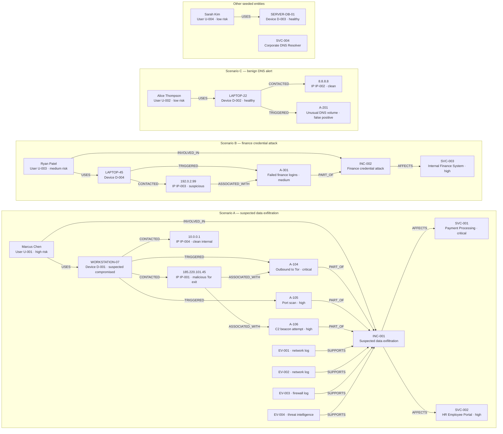

# 🛡️ GraphGuard

> **Every alert has a story. Follow the graph to find it.**

An AI-powered cybersecurity incident investigator that uses **FalkorDB** to traverse relationships among users, devices, IP addresses, alerts, and services — revealing connections that a single-record lookup would miss.

**Graph Hacks 2026 | Track 1: Agents That Act on Connected Data**

- **Project write-up:** [Building GraphGuard: How a Graph Database Transformed Cybersecurity Investigation](https://dev.to/krishnakapoor612/building-graphguard-how-a-graph-database-transformed-cybersecurity-investigation-d49)
- **Demo video:** [Watch GraphGuard on YouTube](https://youtu.be/UB7seRPO52Y)

---

## 🎯 Value Proposition

Traditional security tools analyze alerts in isolation. GraphGuard treats your security data as what it actually is: a **connected graph** of relationships. By storing and querying these relationships in FalkorDB, the AI agent can follow chains like:

```
Alert A-104 → WORKSTATION-07 → Marcus Chen (high-risk) → 185.220.101.45 (Tor exit node)
           ↓                                              ↓
    Incident INC-001 (Data Exfiltration)          Alert A-106 (C2 Beacon)
           ↓
    Payment Service (CRITICAL) + HR Portal (HIGH)
```

This **4-hop discovery** is impossible with a direct alert lookup. It requires a graph.

---

## 🔍 Problem Statement

Security analysts face an **alert fatigue crisis**: thousands of individual alerts, little context. Without graph relationships:

- An analyst sees Alert A-104 as "Suspicious outbound connection" — and may de-prioritize it.
- With GraphGuard, that same alert reveals: same device triggered a port scan 84 minutes earlier, the user has elevated risk level, the destination IP is a known Tor exit node linked to a prior C2 beacon, and two critical services are potentially compromised.

**The graph transforms a low-context alert into an actionable incident narrative.**

---

## 🏗️ Architecture

```
┌─────────────────────────────────────────────────────────────────┐
│                      Streamlit UI                                │
│  Overview | Investigate | Graph Explorer | History               │
└──────────────────────┬──────────────────────────────────────────┘
                       │
┌──────────────────────▼──────────────────────────────────────────┐
│                   Agent Service                                   │
│  Gemini 3.8 Flash + LangChain tool calling                       │
│  Safe predefined tools only — no raw Cypher to LLM               │
└──────┬──────────────┬────────────────┬───────────────────────────┘
       │              │                │
┌──────▼──────┐ ┌─────▼──────┐ ┌──────▼──────────────────────────┐
│Investigation│ │   Memory   │ │       Graph Service              │
│  Service   │ │  Service   │ │  Parameterized Cypher queries    │
│(orchestrate)│ │(persistent)│ │  Bounded traversal, safe reads  │
└──────┬──────┘ └─────┬──────┘ └──────┬──────────────────────────┘
       │              │                │
       └──────────────▼────────────────┘
                      │
              ┌───────▼────────┐
              │   FalkorDB     │
              │  Graph Store   │
              │  (the truth)   │
              └────────────────┘
```

---

## 📊 Graph Data Model

### Node Labels

| Label | Key Properties |
|-------|---------------|
| `User` | id, name, department, role, risk_level |
| `Device` | id, hostname, device_type, status, last_seen |
| `IPAddress` | id, address, reputation, country |
| `Alert` | id, title, severity, category, timestamp, status, description |
| `Incident` | id, title, severity, status, created_at |
| `Service` | id, name, criticality, owner_team |
| `Investigation` | id, question, summary, created_at, outcome |
| `Evidence` | id, source_type, description, observed_at |

### Relationship Types

```cypher
(User)-[:USES]->(Device)
(Device)-[:CONTACTED]->(IPAddress)
(Device)-[:TRIGGERED]->(Alert)
(IPAddress)-[:ASSOCIATED_WITH]->(Alert)
(Alert)-[:PART_OF]->(Incident)
(Incident)-[:AFFECTS]->(Service)
(User)-[:INVOLVED_IN]->(Incident)
(Investigation)-[:EXAMINED]->(Alert)
(Investigation)-[:USED_EVIDENCE]->(Evidence)
(Evidence)-[:SUPPORTS]->(Incident)
```

### Synthetic Demo Graph

The demo seed data contains three main scenarios. The labels below show the entity IDs and the arrows show the relationship types stored in FalkorDB.



The A-104 investigation follows the connected path from the alert through its device, user, IP, related alerts, incident, and affected services. Evidence records support INC-001. The graph also includes the separate finance scenario and the benign A-201 comparison.

### Seed and Runtime Counts

The checked-in seed definitions contain **27 base nodes** (4 users, 4 devices, 4 IP addresses, 5 alerts, 2 incidents, 4 services, and 4 evidence records) and **28 base relationships**. These are the entries in `database/seed.py`; the static seed does not include Investigation nodes.

The Overview page displays live FalkorDB counts, which can grow as investigations are saved. In one local run, the graph showed **29 nodes before investigation activity**, then **32 nodes, 33 relationships, and 5 investigations** afterward. Running an investigation saves a persistent investigation record and links it to the examined alert; the History page reads these saved records. Counts can differ if the graph already contains data from earlier runs.

---

## 🔥 Why FalkorDB is Essential

FalkorDB is not a decoration. It provides three critical capabilities:

### 1. Multi-hop Traversal
A single Cypher query traverses 4+ relationship hops in milliseconds — something that would require multiple round trips and application-level joins in a relational database:

```cypher
MATCH (a:Alert {id: $alert_id})
OPTIONAL MATCH path1 = (d:Device)-[:TRIGGERED]->(a)
OPTIONAL MATCH path2 = (u:User)-[:USES]->(d)
OPTIONAL MATCH path3 = (d)-[:CONTACTED]->(ip:IPAddress)
OPTIONAL MATCH path4 = (ip)-[:ASSOCIATED_WITH]->(related_a:Alert)
OPTIONAL MATCH path5 = (a)-[:PART_OF]->(inc:Incident)
OPTIONAL MATCH path6 = (inc)-[:AFFECTS]->(svc:Service)
RETURN ...
```

### 2. Persistent Investigation Memory
Investigations are stored as graph nodes with relationships to examined alerts and evidence — retrievable across sessions without relying on in-memory chat history.

### 3. Relationship Discovery
"What other alerts share this IP?" requires traversing two relationship types in FalkorDB. In a traditional SIEM, this would require a cross-table join across potentially millions of events.

---

## 🔑 Key Cypher Queries

### Alert with Context (1 hop)
```cypher
MATCH (a:Alert {id: $alert_id})
OPTIONAL MATCH (d:Device)-[:TRIGGERED]->(a)
OPTIONAL MATCH (u:User)-[:USES]->(d)
OPTIONAL MATCH (ip:IPAddress)-[:ASSOCIATED_WITH]->(a)
OPTIONAL MATCH (a)-[:PART_OF]->(inc:Incident)
RETURN a, d, u, ip, inc
```

### Multi-hop Incident Trace (4+ hops)
```cypher
MATCH (a:Alert {id: $alert_id})
OPTIONAL MATCH (d:Device)-[:TRIGGERED]->(a)
OPTIONAL MATCH (u:User)-[:USES]->(d)
OPTIONAL MATCH (d)-[:CONTACTED]->(ip:IPAddress)
OPTIONAL MATCH (ip)-[:ASSOCIATED_WITH]->(related_a:Alert)
OPTIONAL MATCH (a)-[:PART_OF]->(inc:Incident)
OPTIONAL MATCH (inc)-[:AFFECTS]->(svc:Service)
RETURN a, d, u, ip, related_a, inc, svc
```

### Related Alerts via Shared IP
```cypher
MATCH (a:Alert {id: $alert_id})<-[:TRIGGERED]-(d:Device)
      -[:CONTACTED]->(ip:IPAddress)-[:ASSOCIATED_WITH]->(other:Alert)
WHERE other.id <> $alert_id
RETURN other, ip LIMIT 10
```

### Investigation Persistence
```cypher
MERGE (inv:Investigation {id: $inv_id})
SET inv.question = $question,
    inv.summary = $summary,
    inv.created_at = $created_at,
    inv.outcome = $outcome
```

---

## 🤖 Agent Tool Design

The Gemini agent cannot execute arbitrary Cypher. It selects from **7 safe, predefined tools**:

| Tool | Purpose |
|------|---------|
| `get_alert_details(alert_id)` | 1-hop alert context |
| `investigate_device(device_id)` | Device + user + IP + alerts |
| `find_related_alerts(alert_id)` | Multi-hop related alert discovery |
| `trace_incident_path(alert_id)` | Full 4-hop evidence chain |
| `get_affected_services(incident_id)` | Service impact assessment |
| `save_investigation(...)` | Persist to FalkorDB |
| `get_previous_investigation(inv_id)` | Retrieve from persistent memory |

Each tool: validates inputs, returns bounded structured results, handles missing entities gracefully, never interpolates user input into Cypher.

---

## 🔒 Evidence Integrity

GraphGuard enforces a strict separation between **facts** and **inferences**:

- **Confirmed Facts**: Directly returned by graph queries. Labeled as such.
- **Inferences**: AI interpretation. Always prefixed with `[INFERRED]`.
- **Unknowns**: What the graph cannot yet determine. Explicitly listed.

The agent will never:
- Invent node IDs, IP addresses, or paths
- Automatically disable accounts or block IPs
- Claim a successful query if the tool returned no results

---

## 💾 Persistent Memory

When an investigation completes:
1. An `Investigation` node is created in FalkorDB via MERGE (idempotent)
2. It's linked to the examined `Alert` nodes
3. Evidence items are saved as `Evidence` nodes
4. On a follow-up question like "What did we find for A-104?", the app queries FalkorDB — not chat history

---

## 🛠️ Technology Stack

| Component | Technology |
|-----------|-----------|
| Graph Database | FalkorDB (via Docker or cloud) |
| Graph Client | `falkordb` Python client |
| AI Model | Google Gemini 1.5 Flash |
| LLM Framework | LangChain + langchain-google-genai |
| UI | Streamlit |
| Graph Visualization | Plotly |
| Validation | Pydantic v2 |
| Config | python-dotenv |
| Tests | pytest |
| Python | 3.10+ |

---

## ⚙️ Installation & Configuration

### 1. Clone and install

```bash
git clone https://github.com/KrishnaKapoor612/GraphGuard.git
cd GraphGuard
pip install -r requirements.txt
```

### 2. Configure environment

GraphGuard's AI investigation requires **your own Google AI API key**. You also need a reachable FalkorDB instance and must use **your own connection details**. The repository does not provide shared API or database credentials. For an authenticated/hosted FalkorDB instance, enter your own username and password; a local Docker instance may not require them.

```bash
cp .env.example .env
```

On Windows PowerShell, use `Copy-Item .env.example .env` instead. Edit `.env` and set `GOOGLE_API_KEY`, `FALKORDB_HOST`, and `FALKORDB_PORT`. If your FalkorDB instance requires authentication, also set `FALKORDB_USERNAME` and `FALKORDB_PASSWORD`.

To use a managed database instead of running FalkorDB locally, create an instance through [FalkorDB Cloud](https://app.falkordb.cloud/signin), then copy that instance's connection details into your local `.env` file.

Get your own Google AI API key from [Google AI Studio](https://aistudio.google.com/).

### 3. Start FalkorDB

```bash
docker run -p 6379:6379 falkordb/falkordb
```

---

## 🌱 Seed the Demo Graph

```bash
python scripts/seed_demo.py
```

To reset and re-seed:
```bash
python scripts/seed_demo.py --reset
```

This creates:
- 4 users, 4 devices, 4 IP addresses
- 5 alerts (3 suspicious + 1 false positive + 1 auth attack)
- 2 incidents, 4 services, 4 evidence records
- 27 base nodes and 28 base relationships, as defined in `database/seed.py`

---

## 🚀 Start the Application

```bash
streamlit run app.py
```

Open `http://localhost:8501`

---

## 🧪 Run Tests

```bash
python -m pytest tests/ -v
```

14 tests covering:
- Config safety (no secret exposure)
- Graph service layer (mocked DB)
- Investigation orchestration
- Evidence validation
- Inference labeling

---

## 🎬 Example Investigation Questions

1. **"Investigate alert A-104. Is this isolated or connected?"**
   → Reveals 4-hop chain: WORKSTATION-07 → Tor IP → INC-001 → Payment Service

2. **"Is alert A-201 a false positive?"**
   → Traces LAPTOP-22 (Alice) → Google DNS, no incident, confirms false positive

3. **"What did we find when we investigated alert A-104 earlier?"**
   → Retrieves saved investigation from FalkorDB — not from chat history

4. **"What services are at risk from incident INC-001?"**
   → Returns Payment Processing Service (critical) and HR Employee Portal (high)

---

## ⚠️ Limitations & Future Improvements

**Current limitations:**
- Synthetic demo data only — no real SIEM integration
- Single-user, no authentication
- Graph visualization is 2D force layout (not interactive drag)
- FalkorDB requires Docker for local deployment

**Future improvements:**
- SIEM connector (Splunk, Elastic, Sentinel)
- Real-time alert streaming
- Vector similarity search for semantic alert clustering
- Multi-agent architecture: Investigator + Analyst roles
- Graph algorithm integration (shortest path, centrality for pivot point detection)

---
